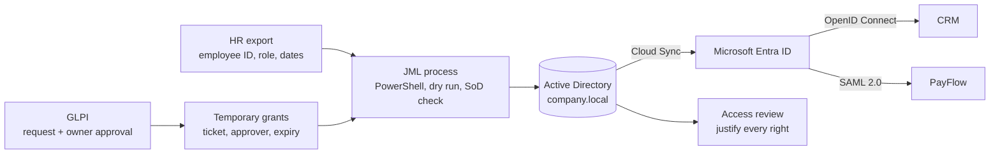

# IAM Access Governance Lab

Building access governance from scratch for a fictitious SME: access policy, role-based access matrix, segregation of duties, ITIL-based access request process, automated joiner-mover-leaver lifecycle, Active Directory delegation and hardening, hybrid identity with Microsoft Entra ID, SSO (SAML / OpenID Connect) and periodic access reviews.

---

## Results at a glance

| Measure | Before | After |
|---|---|---|
| Active Directory risk score (PingCastle, lower is better) | **75 / 100** | **20 / 100** — 5 once the break-glass usage window expires |
| Access rights with a documented justification | none | **32 / 32** (role, approved ticket or delegation) — 0 unexplained |
| Joiner, mover, leaver | manual, case by case | Automated from the HR export, dry run by default, rollback on failure |
| Leaver access cut | — | Same day, in Active Directory **and** in every SSO application |
| Ad hoc access | granted on request, never removed | Ticket → owner approval → automatic removal at expiry |
| Administration | everything with the built-in `Administrator` | Named accounts per tier, least-privilege delegation, just-in-time elevation |
| Traceability | an account vanished without trace ([incident 01](docs/incidents/01-missing-user-account.md)) | Who changed what, when, before and after (events 5136, 4728/4729, 4756/4757, 4688) |

## Scenario

**Company** is a 30-employee SME (Management, Finance, HR, Sales, Marketing, IT). Access rights had always been granted case by case, with no process, no approval trail and no review.

As **access manager**, my mission was to:
1. define who decides and who does what;
2. audit, structure, delegate and harden Active Directory;
3. automate joiners, movers and leavers from the HR source;
4. run every ad hoc access through a tracked ITIL request;
5. extend identities to the cloud with SSO;
6. prove the result with an access review and a before/after audit.

## Architecture

## Environment

Built on top of my previous labs ([network-admin-lab](https://github.com/bilalgh1/network-admin-lab), [sysadmin-lab](https://github.com/bilalgh1/sysadmin-lab)):

| Component | Role |
|---|---|
| Windows Server 2022 — Active Directory `company.local` | Directory, groups, delegation, Cloud Sync agent |
| Windows 11 Enterprise workstation | Domain member, user and delegation tests |
| Ubuntu Server 24.04 — GLPI in Docker | ITIL service desk: access requests and approvals |
| Microsoft Entra ID (free tier) | Hybrid identity, SSO |
| OPNsense | Network segmentation and firewall |

## Phases

| # | Phase | Documents |
|---|---|---|
| 1 | Governance framework | [RACI, default access matrix, segregation of duties](docs/01-governance-framework.md) |
| 2 | Active Directory | [Baseline audit](docs/02-baseline-audit.md) · [Privileged accounts, tiering, delegation](docs/03-privileged-accounts-and-delegation.md) · [Audit and traceability](docs/04-audit-and-traceability.md) · [Windows LAPS](docs/05-laps.md) · [DC hardening, score 75 → 20](docs/06-dc-hardening-and-final-audit.md) |
| 3 | Access lifecycle | [Joiner-mover-leaver process driven by HR](docs/07-joiner-mover-leaver.md) · [Ad hoc requests with GLPI and temporary grants](docs/08-access-requests-glpi.md) |
| 4 | Hybrid identity | [Entra ID Cloud Sync, OpenID Connect and SAML SSO](docs/09-entra-id-hybrid-sso.md) |
| 5 | Control | [Access review campaign and final audit](docs/10-access-review-and-final-audit.md) |

Real incidents met along the way, investigated and documented: [01 — an account disappeared without trace](docs/incidents/01-missing-user-account.md) · [02 — lost administrator credentials, break-glass use](docs/incidents/02-lost-admin-credentials.md) · [03 — domain controller frozen during an update](docs/incidents/03-dc-update-freeze.md).

## Repository

| Path | Content |
|---|---|
| [`docs/`](docs/) | One document per step: context, decisions, commands, evidence, lessons |
| [`scripts/Invoke-Jml.ps1`](scripts/Invoke-Jml.ps1) | Joiner-mover-leaver engine: HR reconciliation, role matrix, temporary grants, SoD checks, rollback, report |
| [`scripts/New-JmlStructure.ps1`](scripts/New-JmlStructure.ps1) | One-time setup: OUs, role groups, least-privilege delegation |
| [`scripts/Export-AccessReview.ps1`](scripts/Export-AccessReview.ps1) | Access review export: justification and reviewer for every right, findings |
| [`config/`](config/) | Role matrix, SoD rules, application owners |
| [`data/`](data/), [`grants/`](grants/) | Fictitious HR export, approved temporary grants |
| [`glpi/`](glpi/) | GLPI deployment (no secrets) |

All names and data are fictitious. No password or secret is stored in this repository.

## Skills demonstrated

| Area | Where |
|---|---|
| Access governance: RACI, birthright access, segregation of duties, access reviews | Phases 1, 3, 5 |
| Active Directory: AGDLP groups, delegation of control, tiering, Protected Users, LAPS, auditing, hardening | Phase 2 |
| ITIL request fulfilment and change management | Phase 3, incident 03 |
| Identity lifecycle automation (joiner, mover, leaver) in PowerShell | Phase 3 |
| Hybrid identity and federation: Entra ID Cloud Sync, OpenID Connect, SAML 2.0, consent, assignment | Phase 4 |
| Audit and evidence: PingCastle, Windows security events, sign-in logs | Phases 2, 4, 5 |

## Next steps

- Move the lifecycle automation to an IGA tool (midPoint): same HR source, roles and SoD rules, with a workflow engine.
- Entra ID P1: group-based application assignment, so the JML process alone grants and revokes application access; Conditional Access.
- Certificate authority: LDAPS for GLPI, code signing for the scripts (`AllSigned`).
- Central log collection (SIEM) for domain controller and Entra ID logs.
